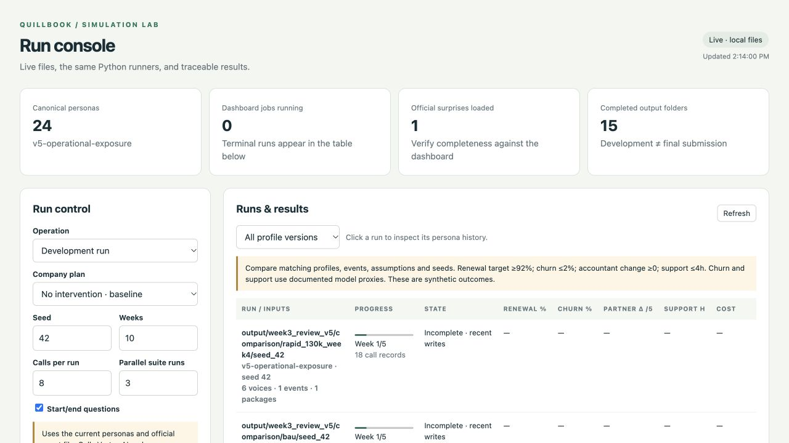

# Customer Simulation with LLM Personas

Team Trinity's project from [Talp's first Simulation Hackathon](https://hackathon.talp.ai) at QNBEYOND Istanbul, October 2026. Built by Batuhan Ok and Ebubekir Erden.

Each team was assigned a fictional US company, simulated how its customers react over 10 difficult weeks, made 2 decisions on the company's behalf and presented the results to a jury. We worked for **Quillbook**, a cloud bookkeeping and payroll provider for 42,000 small businesses heading into a January with new IRS filing rules, minimum wage changes and 4,000 annual plan renewals. Unannounced crises arrived during the day, including late payroll deposits and a US government shutdown.



## What's inside

- **24 LLM personas** across business owners, in-house bookkeepers and partner accountants. Each one has a role, decision authority, operational exposure, behavioral tensions, information habits and a memory that carries over week to week.
- **Population weights** that reconcile the personas to the company's 42,000 customers, 3,100 accountants, 18,000 payroll users and 4,000 due renewals.
- **A relationship network** of 30 adviser and 24 peer links, so advice travels between personas through private messages before they decide.
- **A weekly simulation engine** in Python on Gemini through Vertex AI. The LLM chooses reactions, advice and renewal decisions. Code handles timing, exposure, message routing, validation and metrics.
- **Five matched runs** covering our plan on 2 seeds, no decisions on the same 2 seeds, and our plan with surprise events removed.
- **A local dashboard** for starting runs, following progress week by week and comparing scenarios.
- **Persona interviews** that let you ask any persona about its choices using its saved history.

## Our decisions

| Week | Actions | Cost |
|---|---|---:|
| 5 | Renewal increase of 10% instead of 20%, 40 extra support staff, outside testing for the January update | $950K |
| 8 | Dedicated accountant hotline, public incident reports with text alerts, partner commission raised to 20% | $430K |

Total $1.38M of a $1.5M budget.

## Results

| Scenario | Renewal % | 4 week churn % | Accountant change (1 to 5) | Peak support hours |
|---|---:|---:|---:|---:|
| Plan, seed 42 | 86.00 | 0.329 | +0.52 | 5.67 |
| Plan, seed 43 | 87.88 | 0.074 | +0.55 | 5.66 |
| No decisions, seed 42 | 83.25 | 0.210 | +0.21 | 8.00 |
| No decisions, seed 43 | 83.50 | 0.062 | 0.00 | 8.06 |
| Plan, no surprises | 86.44 | 0.450 | +0.65 | 5.79 |

Against the matching no decision runs, the plan adds 110 to 175 renewals, cuts peak support wait by about 2.3 hours and improves partner accountant satisfaction. All results are synthetic and uncalibrated. Methods, assumptions and limits are explained in [docs/TEAM_DOC.md](docs/TEAM_DOC.md), and the board memo is in [docs/CLIENT_MEMO.md](docs/CLIENT_MEMO.md).

The final presentation is in [docs/board-presentation.pdf](docs/board-presentation.pdf).

## Repository layout

```
code/                 simulation engine, persona builder, dashboard, interview tool
code/data/            personas, relationship network, official events, locked plan
code/14-quillbook.md  the company dossier provided by Talp
code/yeni-case-5-sirket/  the hackathon brief and official submission checker
runs/                 outputs of the five final runs
docs/                 team document, board memo, presentation
```

Each folder in `runs/` holds the weekly persona states, interactions, support records, metrics and audits for one scenario. The raw model call logs (about 10 MB per run) are left out to keep the repository light.

## Running it

Python 3.11 or later and a Vertex AI key are required.

```bash
cd code
python -m venv .venv
.venv/bin/pip install -r requirements.txt
echo "TALP_KEY=your_vertex_key" > .env

.venv/bin/python engine.py validate --locked-plan data/locked_plan.json
.venv/bin/python engine.py suite --locked-plan data/locked_plan.json --events data/official_events.json --parallel-runs 3 --concurrency 24 --output ../reproduced
```

Ask a persona about its decisions

```bash
.venv/bin/python interview.py --run ../runs/plan_1 --persona A08 "Why did you make your final recommendation?"
```

Open the dashboard

```bash
.venv/bin/python project.py ui --port 8765
```

Full details are in [code/README.md](code/README.md).
